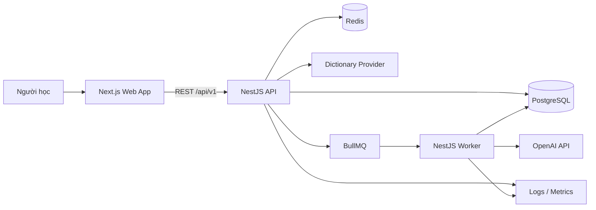
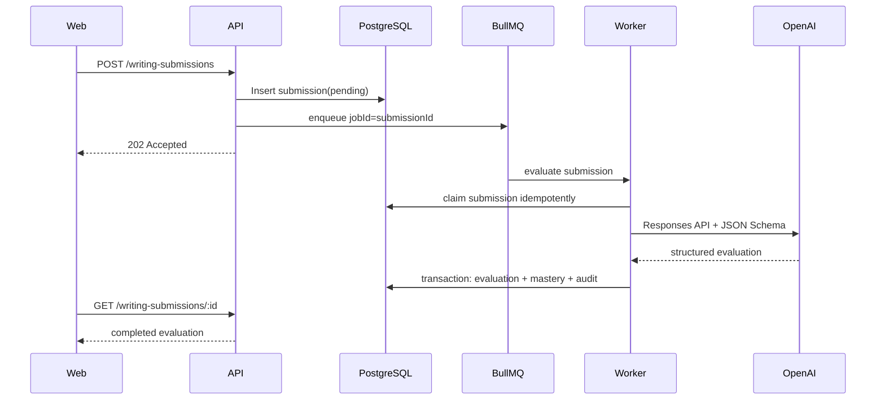
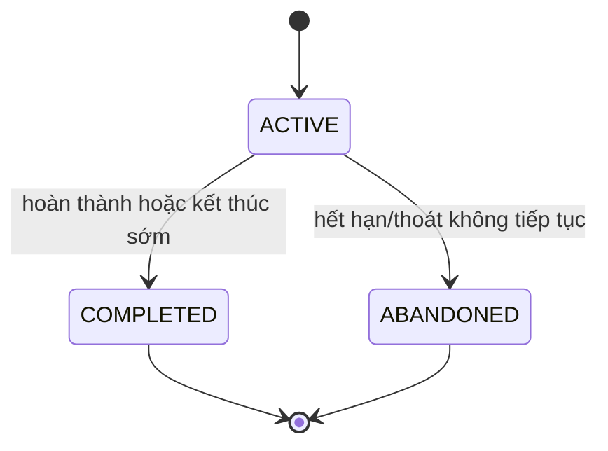
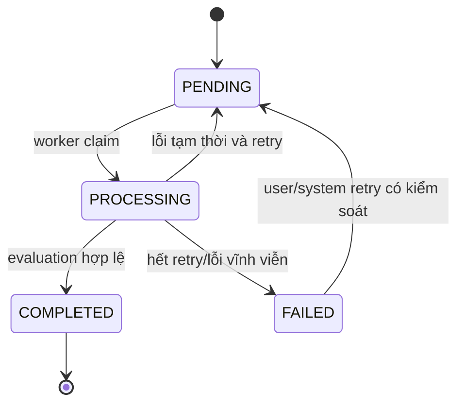
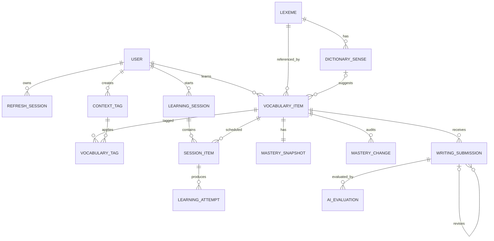

# English Knowledge Management System — Technical Design

> Tài liệu thiết kế kỹ thuật cho phiên bản full-stack. `Describe.md` mô tả tầm nhìn và nghiệp vụ; tài liệu này chuyển các yêu cầu đó thành kiến trúc, mô hình dữ liệu, API, frontend, backend, hạ tầng và kế hoạch triển khai có thể kiểm chứng.

---

## 0. Thông tin tài liệu

| Thuộc tính | Giá trị |
| --- | --- |
| Tên hệ thống | English Knowledge Management System (EKMS) |
| Kiến trúc mục tiêu | TypeScript monorepo, modular monolith, background worker |
| Đối tượng phát hành đầu tiên | Một người học chính, kiến trúc sẵn sàng mở rộng nhiều người dùng |
| Client đầu tiên | Responsive web application |
| API style | REST JSON, versioned API |
| Trạng thái tài liệu | Technical baseline; cập nhật qua ADR và version control |

### 0.1 Cách đọc tài liệu

- Phần 1–4 định nghĩa mục tiêu, phạm vi và kiến trúc tổng thể.
- Phần 5–8 mô tả frontend, backend, domain và dữ liệu.
- Phần 9–13 mô tả API, authentication, AI, cache và background jobs.
- Phần 14–21 mô tả bảo mật, kiểm thử, vận hành, triển khai và roadmap.
- Khi tài liệu này khác với `Describe.md`, ưu tiên quyết định mới nhất đã được ghi trong ADR.

---

# 1. Mục tiêu hệ thống

## 1.1 Mục tiêu sản phẩm

Hệ thống giúp người học biến từ vựng gặp trong ngữ cảnh thật thành kiến thức có thể:

1. Nhận ra và hiểu đúng nghĩa trong ngữ cảnh.
2. Gọi lại được từ khi có nghĩa hoặc tình huống gợi ý.
3. Dùng từ đúng nghĩa, đúng ngữ pháp và tương đối tự nhiên trong câu.
4. Duy trì các năng lực trên qua những lần ôn cách quãng.

Vòng lặp chính:

```text
Gặp từ → Lưu từ và câu gốc → Xác nhận nghĩa → Ôn nhớ
       → Gọi lại từ → Viết câu → Nhận phản hồi → Sửa lại → Lên lịch ôn
```

## 1.2 Mục tiêu kỹ thuật

Dự án đồng thời là một sản phẩm backend/full-stack có chiều sâu, cần thể hiện được:

- Thiết kế domain và ranh giới module rõ ràng.
- Authentication, authorization và quản lý session an toàn.
- Transaction, idempotency và concurrency control.
- Tích hợp Dictionary API và OpenAI qua adapter.
- Xử lý bất đồng bộ bằng queue và worker.
- Cache có chiến lược, không thay thế source of truth.
- Lịch sử bất biến, audit và khả năng thay đổi thuật toán có version.
- Testing nhiều tầng, observability, CI/CD và deployment có thể tái lập.

## 1.3 Chỉ số thành công

### Giá trị cho người học

- Thêm nhanh một từ cùng ngữ cảnh trong khoảng 20 giây.
- Bắt đầu phiên học trong tối đa hai thao tác từ Dashboard.
- Phiên học tuân theo thời lượng người dùng đã chọn.
- Đo riêng khả năng nhận biết, gọi lại và sử dụng từ.
- AI lỗi không làm mất câu viết hoặc cập nhật sai tiến độ.
- Người dùng có thể xem lý do một từ xuất hiện trong phiên ôn.

### Chất lượng kỹ thuật

- Không cộng điểm hoặc ghi attempt hai lần khi client retry request.
- Không có truy cập chéo tài nguyên giữa hai người dùng.
- Mọi thay đổi mastery truy ngược được về attempt và rule version.
- API lỗi có cấu trúc nhất quán và có request ID.
- External service lỗi có timeout, retry giới hạn và fallback.
- Migration có thể chạy tự động và có phương án rollback/forward-fix.

## 1.4 Ngoài phạm vi MVP

- Mobile native.
- Học nhóm, mạng xã hội, thanh toán và marketplace.
- Chat tutor tự do.
- Nhận diện phát âm bằng giọng nói.
- Recommendation bằng machine learning.
- Microservices hoặc Kubernetes.
- Đồng bộ offline nhiều thiết bị với conflict resolution đầy đủ.

---

# 2. Yêu cầu phi chức năng

## 2.1 Hiệu năng mục tiêu

| Hoạt động | Mục tiêu ban đầu |
| --- | --- |
| API CRUD thông thường | p95 dưới 400 ms, không tính mạng client |
| Tạo learning session | p95 dưới 800 ms với dữ liệu MVP |
| Dictionary cache hit | p95 dưới 200 ms |
| Dictionary cache miss | Có timeout; latency phụ thuộc provider |
| Nộp writing submission | API trả `202 Accepted` dưới 500 ms |
| AI evaluation | Xử lý nền; UI hiển thị trạng thái chờ rõ ràng |

Các con số là mục tiêu quan sát, không phải cam kết SLA ở giai đoạn cá nhân.

## 2.2 Độ tin cậy

- PostgreSQL là source of truth.
- Redis có thể mất dữ liệu mà không làm mất lịch sử học.
- Mọi background job phải idempotent.
- Không cập nhật mastery nếu AI evaluation chưa hợp lệ.
- Có health check riêng cho process và readiness check cho dependency.

## 2.3 Bảo mật và riêng tư

- Password chỉ lưu dưới dạng hash mạnh.
- Refresh token chỉ lưu dạng hash hoặc identifier có thể thu hồi.
- Không gửi email, password, access token hoặc dữ liệu hồ sơ không cần thiết cho AI.
- Câu viết gửi tới AI phải được thông báo trong giao diện.
- Mọi truy vấn dữ liệu học phải ràng buộc `userId` từ authenticated principal.

## 2.4 Khả năng bảo trì

- TypeScript strict mode cho toàn monorepo.
- Không trả Prisma model trực tiếp từ controller.
- Business rule quan trọng là pure function/domain service có unit test.
- External provider chỉ được gọi qua interface/port.
- Rule chấm điểm, scheduling và prompt đều có version.

## 2.5 Accessibility và responsive

- Hỗ trợ bàn phím cho toàn bộ phiên quiz.
- Focus state rõ ràng, label đúng cho form và thông báo lỗi có thể đọc bởi screen reader.
- Không dùng màu sắc làm tín hiệu duy nhất.
- Giao diện ưu tiên mobile viewport nhưng vẫn tối ưu desktop.

---

# 3. Công nghệ đề xuất

Không khóa phiên bản cụ thể trong tài liệu này. Phiên bản runtime và package được khóa tại `package.json`, lockfile và Docker image.

| Lớp | Công nghệ | Vai trò |
| --- | --- | --- |
| Monorepo | pnpm workspaces + Turborepo | Quản lý app/package và task graph |
| Ngôn ngữ | TypeScript | Chia sẻ type và tăng độ an toàn |
| Frontend | Next.js + React | Responsive web application |
| UI | Tailwind CSS + bộ component accessible | Thiết kế nhất quán, phát triển nhanh |
| Server state | TanStack Query | Fetch, cache và invalidate API data |
| Form | React Hook Form + Zod | Form state và validation phía client |
| Backend API | NestJS | Modular backend, DI, guard, interceptor |
| ORM | Prisma | Schema, migration và type-safe query |
| Database | PostgreSQL | Source of truth và transaction |
| Cache/Queue | Redis + BullMQ | Cache, rate limit và background jobs |
| AI | OpenAI official JavaScript SDK | Chấm semantic answer và writing |
| API documentation | OpenAPI/Swagger | Contract và manual testing |
| Backend test | Jest + Supertest | Unit, integration và API test |
| Frontend test | Vitest + Testing Library | Component và hook test |
| End-to-end | Playwright | Kiểm tra luồng người dùng trên browser |
| Local infrastructure | Docker Compose | PostgreSQL, Redis và môi trường local |
| CI/CD | GitHub Actions | Lint, test, build, migration và deploy |
| Logging | Pino-compatible structured logger | JSON log, request correlation |

### 3.1 Nguyên tắc chọn công nghệ

- Ưu tiên công nghệ giải quyết một yêu cầu cụ thể.
- Không đưa message broker khác vào khi BullMQ/Redis đã đủ.
- Không tách microservice chỉ để thể hiện kiến trúc.
- Có thể thay Next.js bằng SPA React mà không làm thay đổi API contract.
- Có thể thay AI hoặc Dictionary provider nhờ adapter, không sửa domain logic.

---

# 4. Kiến trúc tổng thể

## 4.1 System context



## 4.2 Runtime components

### Web

- Render giao diện và điều hướng.
- Quản lý form, client validation và server state.
- Không chứa scoring/scheduling business logic.
- Gọi API qua cùng origin `/api` nếu có reverse proxy.

### API

- Xác thực request và kiểm tra ownership.
- Thực hiện CRUD và transaction nghiệp vụ.
- Tạo learning session và ghi learning attempt.
- Tạo writing submission, sau đó enqueue AI job.
- Cung cấp Dashboard read model.

### Worker

- Nhận AI evaluation job từ BullMQ.
- Gọi OpenAI qua adapter.
- Validate structured output.
- Lưu evaluation và cập nhật production mastery trong transaction.
- Retry lỗi tạm thời; không retry lỗi nghiệp vụ vĩnh viễn.

### PostgreSQL

- Lưu user, vocabulary, session, attempt, mastery, writing và audit.
- Là nguồn sự thật duy nhất cho tiến độ học.

### Redis

- Dictionary cache ngắn/trung hạn.
- Rate-limit counters.
- BullMQ queue state.
- Cache read model nếu đo được nhu cầu.
- Không lưu duy nhất dữ liệu không thể tái tạo.

## 4.3 Architectural style

Hệ thống dùng **modular monolith**:

- Một API deployable và một worker deployable.
- Module có ranh giới domain rõ ràng.
- Module giao tiếp bằng public service/application command, không truy cập repository nội bộ của nhau tùy tiện.
- Chỉ tách service khi dữ liệu vận hành thực tế chứng minh nhu cầu scale hoặc ownership độc lập.

## 4.4 Luồng ghi quan trọng



---

# 5. Cấu trúc monorepo

```text
english-knowledge-system/
├── apps/
│   ├── web/                       # Next.js frontend
│   ├── api/                       # NestJS HTTP API
│   └── worker/                    # NestJS/BullMQ worker
├── packages/
│   ├── contracts/                 # DTO-independent schemas/types dùng chung
│   ├── ui/                        # Shared UI components
│   ├── eslint-config/
│   ├── typescript-config/
│   └── test-utils/
├── prisma/
│   ├── schema.prisma
│   ├── migrations/
│   └── seed.ts
├── infra/
│   ├── docker/
│   └── reverse-proxy/
├── docs/
│   ├── adr/
│   ├── api/
│   └── diagrams/
├── .github/workflows/
├── docker-compose.yml
├── package.json
├── pnpm-workspace.yaml
└── turbo.json
```

## 5.1 Quy tắc dependency

- `web` chỉ dùng contracts và UI package; không import code backend.
- `api` và `worker` có thể chia sẻ domain/application package nếu việc tách đó không làm mờ module boundary.
- `contracts` chứa schema request/response ổn định, không chứa Prisma types.
- Domain không import NestJS, Prisma, Redis hoặc OpenAI SDK.
- Infrastructure implement các port do application/domain định nghĩa.

---

# 6. Thiết kế frontend

## 6.1 Route map

```text
/
/login
/register
/dashboard
/vocabulary
/vocabulary/new
/vocabulary/:id
/learn
/learn/:sessionId
/writing/:submissionId
/history
/settings
```

## 6.2 Màn hình và trách nhiệm

| Màn hình | Nội dung chính | Hành động |
| --- | --- | --- |
| Login/Register | Form xác thực | Đăng nhập, tạo tài khoản |
| Dashboard | Thời lượng ước tính, mục đến hạn, từ yếu | Bắt đầu phiên học |
| Quick Add | Từ, câu gốc, nguồn, nghĩa được gợi ý | Xác nhận và lưu |
| Vocabulary List | Search, filter, cursor pagination | Xem, sửa, archive |
| Vocabulary Detail | Sense, context, mastery, timeline | Sửa thông tin, luyện riêng |
| Learning Session | Một activity tại một thời điểm | Nộp đáp án, dùng hint, bỏ qua |
| Writing Feedback | Trạng thái AI, lỗi trọng tâm, revision | Viết lại, phản hồi AI |
| History | Attempt và writing timeline | Xem tiến bộ |
| Settings | Timezone, thời lượng, số từ mới | Cập nhật preference |

## 6.3 Component architecture

```text
app route
  └── feature container
      ├── query/mutation hooks
      ├── feature components
      ├── form schema
      └── presentational UI components
```

Không tạo một global store cho toàn bộ dữ liệu. Phân loại state:

- Server state: TanStack Query.
- URL state: filter, sort, cursor phù hợp chia sẻ/bookmark.
- Form state: React Hook Form.
- Ephemeral UI state: local component state.
- Auth access token: memory; refresh bằng secure cookie.
- Learning session draft: server là nguồn chính, client chỉ giữ input chưa gửi.

## 6.4 API client

API client cần:

- Base URL từ environment.
- Tự gắn `Authorization: Bearer` cho access token.
- Chỉ retry GET/idempotent request với lỗi mạng có giới hạn.
- Khi nhận `401`, thực hiện một refresh request được đồng bộ để tránh refresh storm.
- Parse chuẩn error response và đưa `requestId` vào thông báo hỗ trợ.
- Không tự retry mutation nếu không có `Idempotency-Key`.

## 6.5 Learning session UX

Mỗi activity hiển thị:

- Câu hỏi và ngữ cảnh xác định đúng sense.
- Input hỗ trợ keyboard shortcut.
- Hint là hành động rõ ràng và được ghi nhận trong attempt.
- Sau khi nộp: đáp án, lý do và nút tiếp tục.
- Writing là activity có thể được scheduler chọn hoặc người dùng chủ động mở.

Không hiển thị danh sách 20 câu hỏi cùng lúc. Một activity tại một thời điểm giúp giảm nhiễu và tạo attempt rõ ràng.

## 6.6 Async AI UX

Writing submission đi qua các trạng thái:

```text
draft → submitting → pending → processing → completed
                                  └──────→ failed
```

- `pending/processing`: hiển thị skeleton/progress text; người dùng có thể rời trang.
- `failed_retryable`: cho phép thử lại nhưng giữ nguyên câu đã gửi.
- `failed_permanent`: giải thích ngắn, không cập nhật mastery.
- `completed`: hiển thị `Đạt`, `Cần sửa` hoặc `Sai nghĩa`, không phụ thuộc vào điểm số mơ hồ.

## 6.7 Validation

- Client validation tối ưu trải nghiệm nhưng không thay thế backend validation.
- Shared schema chỉ dùng cho cấu trúc contract ổn định.
- Backend luôn kiểm tra ownership, state transition và business rule.

## 6.8 UI quality checklist

- Loading, empty, error và success state cho mọi query/mutation.
- Optimistic update chỉ dùng cho thao tác có rollback rõ như đổi tag; không dùng cho scoring.
- Confirm trước khi archive nếu thao tác khó thấy lại.
- Không mất draft khi AI/API tạm lỗi.
- Thông báo offline hoặc network unavailable.
- Dark mode là tùy chọn, không phải tiêu chí MVP.

---

# 7. Thiết kế backend

## 7.1 Layer trong mỗi module

```text
presentation/      controllers, DTO, guards
application/       use cases, commands, queries
domain/            entities, value objects, policies, ports
infrastructure/    Prisma repositories, Redis, external clients
```

Không bắt buộc tạo bốn folder cho module rất nhỏ, nhưng dependency luôn đi từ ngoài vào trong.

## 7.2 Module boundaries

### Auth Module

- Register, login, refresh, logout.
- Password hashing.
- Refresh-token rotation và reuse detection.
- Auth guard và current-user principal.

### Users Module

- Profile, timezone và learning preferences.
- Không quản lý token.

### Vocabulary Module

- Lexeme, dictionary sense và vocabulary item của người dùng.
- Context, tag, personal definition, example và archive.
- Không tự quyết định lịch ôn.

### Dictionary Module

- Provider adapter.
- Normalize lookup query.
- Cache, timeout, retry và provider attribution.
- Trả suggestion; không tự lưu thành vocabulary item.

### Learning Module

- Tạo learning session.
- Chọn activity theo priority.
- Ghi attempt.
- Cập nhật mastery và next review trong transaction.
- Chứa scoring/scheduling policy versioned.

### Writing Module

- Writing submission và revision chain.
- State machine của submission.
- Public query cho history/feedback.

### AI Evaluation Module

- Prompt template/version.
- OpenAI adapter.
- Structured output validation.
- Evaluation policy chuyển AI observation thành domain outcome.

### Recommendation Module

- Xếp hạng vocabulary item dựa trên review due, lỗi gần nhất, mastery và user priority.
- Trả cả `priority` và `reasons`.
- Là module nội bộ, không phải microservice.

### Dashboard Module

- Read-only query tổng hợp.
- Không sở hữu business rule.
- Có thể cache sau khi đo query thực tế.

## 7.3 State machines

### Learning session



### Writing submission



Mọi transition phải được kiểm tra phía server. Không cập nhật trạng thái tùy ý bằng generic PATCH.

## 7.4 Transaction boundary

### Nộp learning attempt

Trong một transaction:

1. Xác nhận session đang `ACTIVE` và thuộc user.
2. Xác nhận session item hợp lệ và chưa hoàn thành.
3. Kiểm tra idempotency key.
4. Tạo `LearningAttempt` bất biến.
5. Chạy scoring/scheduling policy.
6. Cập nhật `MasterySnapshot` với optimistic version.
7. Ghi `MasteryChange` chứa lý do và rule version.
8. Đánh dấu session item hoàn thành.

### Hoàn thành AI evaluation

Trong một transaction:

1. Xác nhận submission đang `PROCESSING` hoặc job là retry hợp lệ.
2. Tạo `AIEvaluation` với raw response đã lọc dữ liệu nhạy cảm.
3. Áp dụng evaluation policy.
4. Tạo production attempt nếu evaluation đủ tin cậy.
5. Cập nhật mastery và audit.
6. Chuyển submission sang `COMPLETED`.

## 7.5 Idempotency

- Client gửi `Idempotency-Key` UUID cho mutation quan trọng.
- Server lưu key cùng user, operation và response fingerprint.
- Unique constraint ngăn xử lý hai lần.
- Queue dùng `jobId = writingSubmissionId`.
- Worker kiểm tra trạng thái DB trước khi gọi external API hoặc commit kết quả.

## 7.6 Concurrency

- `MasterySnapshot` có trường `version`.
- Update dùng điều kiện `WHERE id = ? AND version = ?`.
- Nếu conflict, application reload state và tính lại hoặc trả `409 Conflict` tùy use case.
- Không dùng Redis distributed lock cho transaction chỉ liên quan một PostgreSQL database.

---

# 8. Mô hình dữ liệu

## 8.1 Nguyên tắc

- `VocabularyItem` là một nghĩa mà một người dùng thực sự học.
- Dữ liệu từ điển là gợi ý và có thể thay thế.
- Attempt, writing submission và evaluation là lịch sử bất biến.
- Snapshot có thể cập nhật để đọc nhanh nhưng phải audit được.
- Dùng `timestamptz`; tính ngày theo timezone người dùng tại application boundary.
- Dùng UUID hoặc UUIDv7/ULID nhất quán cho public identifier.

## 8.2 ERD cấp cao



## 8.3 Bảng chính

### `users`

| Trường | Ghi chú |
| --- | --- |
| `id` | Primary key |
| `email` | Unique, normalized |
| `password_hash` | Không bao giờ trả qua API |
| `display_name` | Nullable |
| `timezone` | Mặc định theo cấu hình ứng dụng |
| `daily_minutes` | 5/10/15 hoặc giới hạn hợp lệ |
| `max_new_items_per_day` | Preference |
| `created_at`, `updated_at` | Audit timestamps |

### `refresh_sessions`

| Trường | Ghi chú |
| --- | --- |
| `id`, `user_id` | Session identity/owner |
| `token_hash` | Không lưu raw refresh token |
| `family_id` | Phát hiện reuse khi rotate |
| `user_agent`, `ip_hash` | Tùy chính sách riêng tư |
| `expires_at`, `revoked_at` | Lifecycle |
| `replaced_by_id` | Rotation chain |

### `lexemes`

| Trường | Ghi chú |
| --- | --- |
| `id` | Primary key |
| `lemma` | Dạng chuẩn, ví dụ `persistent` |
| `normalized_lemma` | Dùng search/deduplicate |
| `language` | `en` trong MVP |
| `part_of_speech` | Có thể nullable khi mới capture |

Unique đề xuất: `(normalized_lemma, language, part_of_speech)`; cần quy ước rõ khi POS null.

### `dictionary_senses`

| Trường | Ghi chú |
| --- | --- |
| `id`, `lexeme_id` | Quan hệ lexeme |
| `provider` | Tên adapter/provider |
| `provider_sense_id` | ID nguồn nếu có |
| `definition` | Định nghĩa nguồn |
| `examples` | JSONB hoặc bảng con nếu cần query |
| `pronunciation` | JSONB nếu có nhiều accent/form |
| `raw_data` | JSONB phục vụ audit/debug, có retention |
| `fetched_at` | Freshness |

### `vocabulary_items`

| Trường | Ghi chú |
| --- | --- |
| `id`, `user_id`, `lexeme_id` | Item thuộc người học |
| `dictionary_sense_id` | Nullable; dữ liệu tham khảo |
| `definition_vi` | Nghĩa người dùng thực sự học |
| `source_context` | Câu gốc chứa từ |
| `source_name`, `source_url` | Nullable |
| `personal_note` | Nullable |
| `importance` | LOW/NORMAL/HIGH |
| `created_at`, `updated_at`, `archived_at` | Lifecycle |

Không xóa cứng item đã có lịch sử. Có thể cảnh báo duplicate nhưng không cấm hoàn toàn vì một lemma có nhiều sense.

### `learning_sessions`

- `id`, `user_id`.
- `status`: ACTIVE/COMPLETED/ABANDONED.
- `target_minutes`, `planned_item_count`.
- `started_at`, `completed_at`, `expires_at`.

### `session_items`

- `id`, `session_id`, `vocabulary_item_id`.
- `activity_type`: RECOGNITION/RECALL/PRODUCTION.
- `position`, `selection_reasons` JSONB.
- `completed_at`, `skipped_at`.
- Unique `(session_id, position)`.

### `learning_attempts`

- `id`, `user_id`, `vocabulary_item_id`, `session_item_id` nullable.
- `activity_type`.
- `prompt_snapshot` JSONB để lịch sử không thay đổi khi item được sửa.
- `answer_text`.
- `result`: AGAIN/HARD/GOOD/EASY/NEEDS_REVIEW.
- `was_correct`, `used_hint`, `response_time_ms`.
- `evaluator_type`: RULE/USER/AI.
- `idempotency_key`, `created_at`.
- Unique `(user_id, idempotency_key)`.

### `mastery_snapshots`

- Unique `vocabulary_item_id`.
- `recognition_score`, `recall_score`, `production_score`.
- `stability`, `difficulty` nếu scheduling algorithm sử dụng.
- `review_stage`, `last_reviewed_at`, `next_review_at`.
- `learning_state`: NEW/LEARNING/PRACTICING/MASTERED.
- `version`, `scoring_rule_version`, `scheduling_rule_version`.

### `mastery_changes`

- `id`, `vocabulary_item_id`.
- `source_attempt_id` hoặc `source_evaluation_id`.
- `before_snapshot`, `after_snapshot` JSONB.
- `reason`, `rule_version`, `created_at`.

### `writing_submissions`

- `id`, `user_id`, `vocabulary_item_id`.
- `text`, `revision_of_id` nullable.
- `status`: PENDING/PROCESSING/COMPLETED/FAILED.
- `failure_code` nullable.
- `idempotency_key`, timestamps.

### `ai_evaluations`

- `id`, `writing_submission_id`.
- `provider`, `model`, `prompt_version`, `schema_version`.
- `uses_target_sense`, `outcome`, `confidence`.
- `grammar_issues`, `word_choice_issues` JSONB.
- `suggested_sentence`, `explanation_vi`.
- `input_tokens`, `output_tokens`, `estimated_cost` nullable.
- `latency_ms`, `provider_request_id`, `raw_response` có kiểm soát.
- `created_at`.

## 8.4 Index quan trọng

- `users(lower(email))` unique hoặc lưu email đã normalized.
- `vocabulary_items(user_id, archived_at, created_at desc)`.
- `mastery_snapshots(next_review_at)` kết hợp item owner qua join hoặc denormalized có chủ đích.
- `learning_sessions(user_id, status, started_at desc)`.
- `learning_attempts(vocabulary_item_id, created_at desc)`.
- `writing_submissions(user_id, status, created_at)`.
- `ai_evaluations(writing_submission_id, created_at desc)`.

Chỉ tạo index sau khi xác định query cụ thể; kiểm tra bằng `EXPLAIN ANALYZE` với dữ liệu gần thực tế.

## 8.5 Migration và seed

- Migration là immutable sau khi đã lên shared environment.
- CI chạy migration trên database tạm trước khi merge.
- Production chạy `migrate deploy`, không dùng schema push.
- Seed local tạo hai user để kiểm thử ownership, vocabulary mẫu và session mẫu.
- Với migration phá vỡ tương thích, dùng expand → migrate data → contract.

---

# 9. Scoring, mastery và scheduling

## 9.1 Nguyên tắc

- Attempt là source of truth; snapshot là dữ liệu tổng hợp.
- Không trừ mastery chỉ vì người dùng quá hạn.
- Quá hạn chỉ tăng priority và giảm confidence dự đoán nếu thuật toán hỗ trợ.
- Recognition, recall và production cập nhật độc lập.
- Rule có version để có thể thay đổi và replay dữ liệu.

## 9.2 Kết quả một attempt

| Result | Ý nghĩa |
| --- | --- |
| `AGAIN` | Sai hoặc không nhớ |
| `HARD` | Đúng sau hint, chậm hoặc thiếu chắc chắn |
| `GOOD` | Đúng không cần hỗ trợ |
| `EASY` | Đúng nhanh và tự tin; chỉ dùng khi rule rõ |
| `NEEDS_REVIEW` | Không đủ dữ liệu để tự chấm |

Backend có thể suy ra result từ `wasCorrect`, `usedHint` và response time; người dùng được phép override khi semantic answer bị chấm sai.

## 9.3 Lịch ôn MVP

Khởi đầu bằng policy đơn giản, deterministic:

- `AGAIN`: ôn lại cuối phiên hoặc ngày kế tiếp.
- `HARD`: interval ngắn hơn mốc hiện tại.
- `GOOD`: tiến qua 1 → 3 → 7 → 14 → 30 ngày.
- `EASY`: có thể bỏ qua một mốc.
- Production chưa đạt không xóa toàn bộ tiến độ recognition/recall.

Khi có đủ dữ liệu sử dụng thật, có thể thay bằng thuật toán SRS thích nghi. Không thay đổi API contract; chỉ thay `SchedulingPolicy` và tăng version.

## 9.4 Mastered

Một item chỉ `MASTERED` khi:

- Recognition và recall đạt ngưỡng.
- Có ít nhất hai production attempt đạt ở những ngày khác nhau.
- Có một lần recall thành công sau interval đủ dài.
- Không có lỗi nghiêm trọng gần đây làm mất nghĩa mục tiêu.

Trạng thái `DUE` không phải learning state; nó được suy ra từ `nextReviewAt <= now`.

## 9.5 Recommendation priority

```text
priority =
    overdueWeight
  + recentFailureWeight
  + lowRecallWeight
  + lowProductionWeight
  + userImportanceWeight
  - recentlySeenPenalty
```

Mỗi session item lưu `selection_reasons`, ví dụ:

```json
[
  "OVERDUE_3_DAYS",
  "FAILED_LAST_RECALL",
  "HIGH_USER_IMPORTANCE"
]
```

---

# 10. API design

## 10.1 Quy ước chung

- Base path: `/api/v1`.
- JSON dùng `camelCase`; database có thể dùng `snake_case`.
- Timestamp trả ISO 8601 UTC.
- ID public là opaque string.
- Request validation bật whitelist và reject field không hợp lệ khi phù hợp.
- OpenAPI là tài liệu contract có thể sinh client/type nếu quyết định sau này.
- Không lộ stack trace, Prisma error hoặc provider secret cho client.

## 10.2 Success response

Resource đơn:

```json
{
  "data": {
    "id": "..."
  }
}
```

Collection:

```json
{
  "data": [],
  "pageInfo": {
    "nextCursor": null,
    "hasNextPage": false
  }
}
```

## 10.3 Error response

```json
{
  "error": {
    "code": "VOCABULARY_ITEM_NOT_FOUND",
    "message": "Không tìm thấy từ vựng.",
    "details": [],
    "requestId": "req_..."
  }
}
```

Error code ổn định cho client; message có thể thay đổi/localize.

## 10.4 Endpoint chính

### Auth

```http
POST   /api/v1/auth/register
POST   /api/v1/auth/login
POST   /api/v1/auth/refresh
POST   /api/v1/auth/logout
POST   /api/v1/auth/logout-all
GET    /api/v1/auth/sessions
DELETE /api/v1/auth/sessions/:id
```

### User

```http
GET    /api/v1/me
PATCH  /api/v1/me
GET    /api/v1/me/preferences
PATCH  /api/v1/me/preferences
```

### Dictionary

```http
GET /api/v1/dictionary/lookups?query=persistent&language=en
```

### Vocabulary

```http
POST   /api/v1/vocabulary-items
GET    /api/v1/vocabulary-items?query=&state=&tag=&cursor=
GET    /api/v1/vocabulary-items/:id
PATCH  /api/v1/vocabulary-items/:id
POST   /api/v1/vocabulary-items/:id/archive
POST   /api/v1/vocabulary-items/:id/restore
GET    /api/v1/vocabulary-items/:id/history
```

### Learning

```http
POST /api/v1/learning-sessions
GET  /api/v1/learning-sessions/:id
POST /api/v1/learning-sessions/:id/attempts
POST /api/v1/learning-sessions/:id/complete
POST /api/v1/learning-sessions/:id/abandon
```

### Writing

```http
POST /api/v1/writing-submissions
GET  /api/v1/writing-submissions/:id
POST /api/v1/writing-submissions/:id/retry-evaluation
POST /api/v1/writing-submissions/:id/revisions
POST /api/v1/writing-submissions/:id/evaluation-feedback
```

### Dashboard

```http
GET /api/v1/dashboard
GET /api/v1/progress?from=&to=
```

## 10.5 Tạo learning session

Request:

```json
{
  "targetMinutes": 10,
  "includeNewItems": true
}
```

Response `201 Created`:

```json
{
  "data": {
    "id": "session_id",
    "status": "ACTIVE",
    "estimatedMinutes": 9,
    "totalItems": 12,
    "currentItem": {
      "id": "session_item_id",
      "activityType": "RECALL",
      "prompt": {
        "definitionVi": "kiên trì",
        "sourceContext": "..."
      }
    }
  }
}
```

Không gửi đáp án đầy đủ trong payload câu hỏi nếu client không cần nó.

## 10.6 Nộp attempt

Header:

```http
Idempotency-Key: 61c715a8-...
```

Request:

```json
{
  "sessionItemId": "...",
  "answer": "persistent",
  "usedHint": false,
  "responseTimeMs": 4200
}
```

Response trả kết quả, giải thích, mastery summary và next item. Server không tin `responseTimeMs` cho mục đích bảo mật; dữ liệu này chỉ là tín hiệu học tập.

## 10.7 Async response

`POST /writing-submissions` trả `202 Accepted`:

```json
{
  "data": {
    "id": "submission_id",
    "status": "PENDING",
    "statusUrl": "/api/v1/writing-submissions/submission_id"
  }
}
```

## 10.8 Pagination

- Dùng cursor cho vocabulary/history có thể lớn dần.
- Cursor là opaque base64 hoặc signed payload.
- Có giới hạn `limit` tối đa.
- Sort field phải nằm trong allowlist.

---

# 11. Authentication và authorization

## 11.1 Token strategy

- Access token JWT sống ngắn, client giữ trong memory.
- Refresh token random/opaque hoặc JWT có rotation, đặt trong `HttpOnly`, `Secure`, `SameSite=Lax` cookie.
- Database lưu refresh session và token hash.
- Mỗi refresh rotate token; phát hiện token cũ bị reuse thì revoke toàn family.
- Reverse proxy cung cấp cùng origin cho web/API để giảm CORS và cookie complexity.

## 11.2 Password

- Hash bằng Argon2id hoặc bcrypt với cost được benchmark trên môi trường deploy.
- Giới hạn độ dài input hợp lý để tránh DoS qua hashing.
- Không log password hoặc body của auth endpoint.
- Generic login error tránh tiết lộ email tồn tại.

## 11.3 Authorization

Không chỉ kiểm tra user đã login. Mọi repository query cho tài nguyên người dùng phải bao gồm ownership:

```text
find vocabulary item where id = :id and user_id = currentUser.id
```

Không query theo ID rồi mới kiểm tra owner nếu việc đó tạo nguy cơ quên guard ở một path khác.

## 11.4 CSRF và CORS

- Refresh/logout dùng cookie phải kiểm soát Origin và CSRF theo topology deploy.
- Access token bearer trong memory giảm bề mặt CSRF cho API nghiệp vụ.
- CORS allowlist chính xác; không dùng wildcard với credential.

## 11.5 Rate limit

Rate limit riêng cho:

- Login/register/refresh.
- Dictionary lookup cache miss.
- Semantic AI check.
- Writing submission/retry.

Trả `429` và `Retry-After` khi phù hợp.

---

# 12. OpenAI integration

## 12.1 Phạm vi sử dụng

OpenAI chỉ được dùng cho:

- Semantic check khi rule-based comparison không đủ chắc chắn.
- Đánh giá câu viết theo target sense.
- Gợi ý sửa và giải thích học tập ngắn gọn.

Không gọi AI cho mọi quiz nếu normalized exact match/synonym rule đã quyết định được.

## 12.2 API và structured output

Dùng OpenAI Responses API qua official JavaScript SDK. Kết quả chấm phải dùng Structured Outputs với JSON Schema, sau đó vẫn được kiểm tra bằng schema runtime ở application boundary. Structured Outputs được thiết kế để kết quả tuân theo JSON Schema do ứng dụng cung cấp; tài liệu chính thức: <https://developers.openai.com/api/docs/guides/structured-outputs>.

Không hard-code model name trong domain. Model được cấu hình theo environment và được lưu cùng mỗi evaluation.

## 12.3 Evaluation schema

Schema logic:

```json
{
  "usesTargetSense": true,
  "grammarStatus": "MINOR_ISSUES",
  "naturalness": "ACCEPTABLE",
  "confidence": 0.92,
  "grammarIssues": [
    {
      "span": "...",
      "code": "...",
      "explanationVi": "..."
    }
  ],
  "wordChoiceIssues": [],
  "suggestedSentence": "...",
  "explanationVi": "..."
}
```

Enum phải hữu hạn. Field bắt buộc/nullable phải được định nghĩa rõ trong JSON Schema.

## 12.4 Prompt input

Prompt cần chứa tối thiểu:

- Target lemma.
- Part of speech.
- Target definition/sense.
- Câu ngữ cảnh gốc nếu có.
- Câu người dùng viết.
- Rubric và output schema/version.

Dữ liệu người dùng phải được đặt trong delimiter rõ ràng và được xem là untrusted content. Không cho câu người dùng thay đổi system instruction hoặc rubric.

## 12.5 Domain policy sau AI

AI trả observation; backend quyết định outcome:

```text
IF usesTargetSense = false
  → WRONG_SENSE
ELSE IF confidence < configuredThreshold
  → NEEDS_REVIEW
ELSE IF grammarStatus = BLOCKING OR naturalness = UNNATURAL
  → REVISE
ELSE
  → PASS
```

Không dùng một `score >= 7` duy nhất làm business rule.

## 12.6 Reliability

- Timeout ở client.
- Retry tối đa có giới hạn cho timeout, connection reset và một số 5xx/429.
- Exponential backoff có jitter.
- Không retry schema/policy validation error vô hạn.
- Lưu failure code có phân loại.
- Circuit breaker là P1 nếu provider failure gây backlog lớn.
- Queue concurrency giới hạn theo rate limit và ngân sách.

## 12.7 Cost control

- Lưu token usage và cost ước lượng khi có dữ liệu phù hợp.
- Giới hạn chiều dài câu/context gửi đi.
- Không gửi toàn bộ lịch sử học nếu không cần.
- Theo dõi cost theo user, feature, model và prompt version.
- Có daily/monthly budget alert ở hạ tầng hoặc application metrics.

## 12.8 Quality evaluation

Tạo một bộ fixture gồm các câu:

- Đúng nghĩa và tự nhiên.
- Đúng nghĩa nhưng sai ngữ pháp nhẹ.
- Đúng từ nhưng sai target sense.
- Câu vô nghĩa hoặc cố prompt injection.
- Trường hợp gây tranh cãi cần `NEEDS_REVIEW`.

Mỗi lần đổi prompt/model/schema phải chạy regression eval trên fixture trước khi deploy.

## 12.9 User control

- Người dùng có thể báo AI chấm sai.
- Feedback được lưu cùng evaluation ID và reason.
- Override không sửa raw evaluation; tạo quyết định mới có audit.

---

# 13. Dictionary, Redis và background jobs

## 13.1 Dictionary provider port

```ts
interface DictionaryProvider {
  lookup(input: {
    query: string;
    language: string;
  }): Promise<DictionaryLookupResult>;
}
```

Domain không biết response gốc của provider.

## 13.2 Dictionary cache

Cache key:

```text
dictionary:{provider}:{language}:{normalizedQuery}:v{adapterVersion}
```

- Cache positive result với TTL phù hợp license/freshness.
- Negative cache có TTL ngắn để tránh gọi lặp từ không tồn tại.
- Có manual fallback khi provider lỗi hoặc không có nghĩa phù hợp.
- Không cache dữ liệu riêng tư trong dictionary cache.

## 13.3 BullMQ queues

Queue ban đầu:

```text
ai-evaluation
maintenance
```

Job `ai-evaluation`:

- `jobId = writingSubmissionId`.
- Payload chỉ chứa identifier; worker đọc dữ liệu mới nhất từ DB.
- Có attempts/backoff giới hạn.
- Failed jobs được giữ đủ lâu để debug nhưng có retention policy.
- Có dead-letter handling hoặc admin script để requeue an toàn.

## 13.4 Chống mất job

MVP:

- Commit submission vào DB.
- Enqueue job với deterministic `jobId`.
- Scheduled reconciliation tìm submission `PENDING` chưa có job và enqueue lại.

P1 có thể dùng transactional outbox nếu yêu cầu reliability tăng. Không cần triển khai outbox trước khi có test chứng minh luồng reconciliation chưa đủ.

## 13.5 Cache invalidation

- Vocabulary mutation invalidate list/detail/dashboard liên quan.
- Learning attempt invalidate session, detail và dashboard.
- AI completion invalidate submission, vocabulary history và dashboard.
- Cache key có version để thay đổi shape an toàn.

---

# 14. Security design

## 14.1 Threats chính

| Threat | Kiểm soát |
| --- | --- |
| Broken object-level authorization | Query luôn kèm `userId`, E2E cross-user tests |
| Credential stuffing | Rate limit, generic error, session visibility |
| Refresh token theft/reuse | HttpOnly cookie, rotation, family revocation |
| Injection | Parameterized Prisma query, validation, không ghép SQL tùy ý |
| XSS | React escaping, sanitize rich content, CSP |
| CSRF | SameSite, Origin check, CSRF token khi topology yêu cầu |
| AI prompt injection | Delimiter, fixed rubric/schema, treat user text as data |
| Secret leakage | Environment/secret store, log redaction |
| Abuse gây tốn chi phí AI | Rate limit, quota, queue concurrency, budget alerts |
| Duplicate mutation | Idempotency key và unique constraint |

## 14.2 Validation và serialization

- Global validation pipe có transform/whitelist rõ ràng.
- Limit kích thước request body.
- Giới hạn chiều dài lemma, definition, context và writing text.
- Response DTO loại bỏ password hash, token hash và internal fields.

## 14.3 Headers

- HTTPS production.
- HSTS sau khi HTTPS ổn định.
- CSP cho web.
- `X-Content-Type-Options: nosniff`.
- Referrer policy phù hợp.
- Không dựa vào header cũ như một biện pháp duy nhất chống XSS.

## 14.4 Data lifecycle

- Archive vocabulary thay vì hard delete khi còn history.
- Có chức năng export/delete account ở giai đoạn multi-user production.
- Raw AI/dictionary response có retention và redaction policy.
- Backup được mã hóa bởi provider/hạ tầng và kiểm thử restore định kỳ.

---

# 15. Observability

## 15.1 Structured logging

Mỗi log quan trọng có:

- Timestamp, level, service name và environment.
- `requestId`/correlation ID.
- `userId` dạng identifier nội bộ khi cần, không log email mặc định.
- Route, status code và duration.
- External provider, latency và failure category.
- Queue name, job ID và attempt number.

Redact:

- Authorization/Cookie.
- Password và token.
- OpenAI API key.
- Nội dung prompt/câu viết nếu log không thực sự cần.

## 15.2 Metrics

### API

- Request count, error rate, latency theo route/status.
- Auth failure/rate-limit count.
- Database query latency và pool saturation.

### Queue/AI

- Queue depth, oldest job age, processing duration.
- Retry/failure count.
- Token usage và estimated cost.
- Evaluation outcome và user disagreement rate.

### Product

- Số từ thêm mới.
- Session completion rate.
- Attempt theo activity type/result.
- Review backlog và overdue distribution.
- Retention/recall success theo interval.

## 15.3 Health endpoints

```http
GET /health/live
GET /health/ready
```

- Liveness chỉ xác nhận process không bị kẹt nghiêm trọng.
- Readiness kiểm tra database và dependency bắt buộc; Redis/OpenAI có thể được báo degraded tùy khả năng fallback.

## 15.4 Alert ban đầu

- API 5xx tăng bất thường.
- Database không kết nối được.
- Queue oldest-job age vượt ngưỡng.
- AI failure/cost vượt ngưỡng.
- Disk/storage hoặc connection pool gần giới hạn.

---

# 16. Testing strategy

## 16.1 Test pyramid

### Unit tests

Tập trung vào:

- Normalize vocabulary/answer.
- Scoring policy.
- Scheduling policy.
- Recommendation priority.
- Mastery state transition.
- AI evaluation policy.
- Refresh-token rotation rules.

Unit test không cần Nest application hoặc database.

### Integration tests

Chạy với PostgreSQL/Redis thật trong container hoặc CI service:

- Prisma repository và transaction.
- Unique constraint/idempotency.
- Optimistic concurrency.
- Queue producer/consumer.
- Cache behavior.
- Auth session lifecycle.

Không mock Prisma cho những test cần chứng minh query/constraint.

### Contract tests

- Dictionary adapter với recorded fixture hợp lệ, lỗi và response thiếu field.
- OpenAI adapter với mocked SDK response theo JSON schema.
- API response phù hợp OpenAPI/schema.

### E2E tests

Các luồng tối thiểu:

1. Register → login → refresh → logout.
2. Lookup → lưu một sense → mở detail.
3. Tạo session → nộp attempt → thấy mastery/lịch ôn đổi.
4. Nộp writing → worker hoàn thành → xem feedback → tạo revision.
5. AI lỗi → submission không mất → retry thành công.
6. User A không đọc/sửa được dữ liệu User B.
7. Gửi cùng idempotency key hai lần không tạo hai attempt.

### Frontend tests

- Form validation và error mapping.
- Loading/empty/error states.
- Auth refresh flow.
- Learning keyboard flow.
- Async writing status UI.
- Playwright responsive smoke test.

## 16.2 Test data

- Factory tạo user, vocabulary item và mastery state.
- Fixed clock để test scheduling ổn định.
- Không phụ thuộc thời gian thực hoặc timezone máy CI.
- Không gọi OpenAI/Dictionary thật trong test mặc định.
- Có smoke test thủ công hoặc opt-in cho sandbox external provider.

## 16.3 Coverage policy

Không chạy theo một tỷ lệ coverage tuyệt đối. Bắt buộc branch coverage tốt cho:

- Auth/session security rules.
- Scoring/scheduling state transition.
- Idempotency và failure recovery.
- AI policy.

---

# 17. Configuration và environments

## 17.1 Environments

| Environment | Mục đích |
| --- | --- |
| local | Development với Docker Compose |
| test | Automated tests, database tạm |
| staging | Migration, E2E và kiểm tra integration |
| production | Dữ liệu thật |

## 17.2 Environment variables

Nhóm biến cấu hình:

```text
APP_ENV
API_PORT
WEB_ORIGIN
DATABASE_URL
REDIS_URL
JWT_ACCESS_SECRET
ACCESS_TOKEN_TTL
REFRESH_TOKEN_TTL
OPENAI_API_KEY
OPENAI_MODEL
OPENAI_TIMEOUT_MS
DICTIONARY_PROVIDER
DICTIONARY_API_KEY
LOG_LEVEL
```

- Validate toàn bộ config khi process khởi động.
- Không commit `.env` thật.
- Có `.env.example` không chứa secret.
- Secret production được cấp qua platform secret manager.

## 17.3 Feature flags

Feature flag tối thiểu có thể dùng cho:

- Bật/tắt semantic AI quiz.
- Chọn scoring/scheduling version mới.
- Bật model/prompt candidate cho một tỷ lệ evaluation.

Không xây một feature-flag platform riêng trong MVP.

---

# 18. Local development

## 18.1 Docker Compose services

```text
postgres
redis
```

Web/API/worker có thể chạy bằng local Node.js để hot reload nhanh; có Dockerfile cho integration và production.

## 18.2 Script contract đề xuất

```text
pnpm dev
pnpm dev:web
pnpm dev:api
pnpm dev:worker
pnpm lint
pnpm typecheck
pnpm test
pnpm test:integration
pnpm test:e2e
pnpm build
pnpm db:migrate
pnpm db:seed
pnpm db:studio
```

## 18.3 Developer onboarding

README triển khai cần cho phép developer mới:

1. Cài runtime và pnpm.
2. Copy `.env.example`.
3. Khởi động PostgreSQL/Redis.
4. Chạy migration và seed.
5. Chạy web/API/worker.
6. Mở Swagger và tài khoản seed.

Mục tiêu: local setup thành công mà không cần kiến thức ngầm từ tác giả.

---

# 19. CI/CD và deployment

## 19.1 Pull request pipeline

```text
install frozen lockfile
  → lint
  → typecheck
  → unit tests
  → integration tests
  → build web/api/worker
  → migration validation
  → optional Playwright smoke
```

## 19.2 Main branch/deploy pipeline

1. Build immutable image cho API và worker; build web artifact/image.
2. Scan dependency/image theo khả năng hạ tầng.
3. Deploy staging.
4. Chạy migration theo chiến lược backward-compatible.
5. Chạy smoke/E2E test.
6. Manual approval hoặc auto deploy production tùy giai đoạn.
7. Ghi release identifier vào log/health info.

## 19.3 Deployment topology ban đầu

### Lựa chọn đơn giản

- Web deploy trên platform hỗ trợ Next.js.
- API và worker là hai process/container.
- Managed PostgreSQL.
- Managed Redis.
- Reverse proxy/domain routing `/api` tới backend.

### VPS thay thế

- Docker Compose production cho web/API/worker/reverse proxy.
- PostgreSQL/Redis managed vẫn được ưu tiên nếu ngân sách cho phép.
- HTTPS tự động qua reverse proxy.
- Có backup, log rotation và update process rõ ràng.

## 19.4 Docker image

- Multi-stage build.
- Chạy bằng non-root user.
- Chỉ copy production dependency/artifact cần thiết.
- Có health check phù hợp.
- Pin runtime base image theo digest hoặc version policy.

## 19.5 Database release safety

- Backup/snapshot trước migration rủi ro cao.
- Migration backward-compatible trước khi deploy code mới.
- Không rollback code nếu schema cũ không còn tương thích; ưu tiên forward-fix.
- Test restore backup, không chỉ xác nhận backup tồn tại.

---

# 20. Khả năng mở rộng và failure handling

## 20.1 Scale path

Thứ tự tối ưu hợp lý:

1. Đo latency và query.
2. Thêm/chỉnh index.
3. Giảm N+1 và payload.
4. Cache read model có lợi rõ.
5. Scale API/worker ngang.
6. Tách workload chỉ khi module có profile scale khác biệt.

Không bắt đầu bằng microservices.

## 20.2 Dependency failure matrix

| Dependency lỗi | Hành vi hệ thống |
| --- | --- |
| PostgreSQL | API mutation/read quan trọng unavailable; readiness fail |
| Redis cache | Dictionary có thể gọi provider trực tiếp với rate guard; dashboard không phụ thuộc cache |
| Redis queue | Vẫn lưu writing submission; reconciliation enqueue lại sau |
| Dictionary API | Hiển thị nhập tay; không chặn thêm từ |
| OpenAI API | Submission giữ nguyên, trạng thái failed/retryable; không đổi mastery |
| Web deploy lỗi | API/worker và dữ liệu không bị ảnh hưởng; rollback web artifact |

## 20.3 Data growth

Các bảng tăng nhanh nhất:

- `learning_attempts`.
- `mastery_changes`.
- `ai_evaluations` và raw payload.
- Queue job history.

Cần retention cho raw provider response/job logs, nhưng không xóa lịch sử học cốt lõi nếu chưa có chính sách rõ.

---

# 21. Roadmap triển khai 6 tuần

## Tuần 1 — Foundation và Auth

- Khởi tạo monorepo, shared config và CI cơ bản.
- Docker Compose PostgreSQL/Redis.
- NestJS API, Next.js web shell và worker shell.
- Prisma schema nền, migration và seed.
- Register/login/refresh/logout.
- Error format, logging, Swagger và health endpoints.

**Demo cuối tuần:** đăng ký, đăng nhập, refresh session và xem profile trên web.

## Tuần 2 — Vocabulary vertical slice

- Dictionary provider adapter và Redis cache.
- Lexeme, dictionary sense và vocabulary item.
- Quick Add UI.
- List/detail/edit/archive.
- Ownership integration tests.

**Demo cuối tuần:** tra `persistent`, lưu nghĩa cùng câu gốc, xem và sửa item.

## Tuần 3 — Learning engine

- Learning session/session item.
- Recognition và recall activity.
- Attempt transaction, idempotency và mastery snapshot.
- Scheduling policy v1 và recommendation priority.
- Learning UI keyboard-first.

**Demo cuối tuần:** hoàn thành một phiên, refresh/retry không cộng trùng, thấy ngày ôn tiếp theo.

## Tuần 4 — Writing và AI

- Writing submission/revision.
- BullMQ worker và reconciliation.
- OpenAI adapter + Structured Outputs.
- Prompt/schema/policy versioning.
- Async status và feedback UI.

**Demo cuối tuần:** gửi câu, rời trang, quay lại xem đánh giá và sửa câu.

## Tuần 5 — Dashboard, history và hardening

- Dashboard read model.
- Vocabulary timeline/history.
- Rate limit, CSRF/CORS/security headers.
- Metrics và AI usage/cost logging.
- Query/index review.

**Demo cuối tuần:** dùng hệ thống như một sản phẩm hàng ngày và quan sát được lỗi/chi phí.

## Tuần 6 — Quality và release

- E2E luồng chính và cross-user authorization.
- Concurrency/idempotency/failure tests.
- Responsive/accessibility pass.
- Production Docker images và deploy staging.
- Migration/backup/restore rehearsal.
- Production release và runbook.

**Demo cuối tuần:** deployment hoàn chỉnh, có health checks, logs, rollback/forward-fix plan.

---

# 22. Definition of Done

Một feature chỉ hoàn thành khi:

- Acceptance criteria nghiệp vụ đạt.
- API contract và validation hoàn chỉnh.
- Ownership/authorization đã kiểm tra.
- Unit/integration/E2E test tương ứng chạy qua.
- Loading/error/empty state có trên frontend.
- Log/metric cần thiết đã có và không lộ secret.
- Migration/index được review nếu thay schema.
- Documentation/ADR được cập nhật nếu có quyết định kiến trúc.
- Chạy được trong local, CI và staging.

MVP hoàn thành khi một user mới có thể:

1. Tạo tài khoản và đăng nhập an toàn.
2. Tra và lưu một từ cùng target sense/ngữ cảnh.
3. Tạo phiên học và làm recognition/recall quiz.
4. Nộp câu viết, nhận AI feedback bất đồng bộ và tạo revision.
5. Xem lịch sử, mastery dimensions và lịch ôn tiếp theo.
6. Gặp lỗi Dictionary/AI mà không mất dữ liệu.
7. Không thể truy cập dữ liệu của user khác.

---

# 23. ADR cần tạo

Mỗi ADR ngắn gọn gồm Context, Decision, Alternatives, Consequences.

Danh sách ban đầu:

- ADR-001: Modular monolith thay vì microservices.
- ADR-002: Next.js web + NestJS REST API tách biệt.
- ADR-003: PostgreSQL là source of truth; Redis chỉ là hạ tầng tạm/tái tạo được.
- ADR-004: Access token trong memory và refresh token HttpOnly cookie.
- ADR-005: BullMQ worker cho AI evaluation.
- ADR-006: Attempt là source of truth, mastery là snapshot có audit.
- ADR-007: OpenAI Responses API với Structured Outputs và provider adapter.
- ADR-008: Scheduling policy versioned.

---

# 24. Rủi ro và biện pháp

| Rủi ro | Tác động | Giảm thiểu |
| --- | --- | --- |
| Scope quá lớn trong 6 tuần | Không có vertical slice dùng được | Demo chạy được mỗi tuần, P0/P1 rõ ràng |
| AI chấm không ổn định | Mất niềm tin, mastery sai | Structured output, policy, fixture eval, user override |
| Dictionary sense không phù hợp | Người dùng lưu sai nghĩa | Lưu câu gốc, cho sửa definition và nhập tay |
| Queue mất job | Submission treo | Deterministic job ID + reconciliation |
| Duplicate request | Cộng điểm hai lần | Idempotency key + unique constraint + transaction |
| Broken authorization | Lộ dữ liệu | Ownership query pattern + cross-user E2E |
| Redis bị dùng như source of truth | Mất dữ liệu | PostgreSQL authoritative, fallback/rebuild cache |
| Roadmap thiên backend, UX bị bỏ quên | Sản phẩm không được dùng thật | Vertical slice luôn gồm frontend và dogfooding |
| Thuật toán score sai | Số liệu gây hiểu lầm | Ba mastery dimensions, attempt history, rule version |

---

# 25. Các quyết định còn mở

Những điểm cần chốt trước hoặc trong tuần 1:

1. Dictionary provider nào có license và dữ liệu phù hợp, đặc biệt với nghĩa tiếng Việt?
2. Deployment dùng managed platform hay VPS?
3. Web/API cùng origin bằng reverse proxy hay khác subdomain?
4. Access token TTL và refresh session policy cụ thể?
5. Có cho người dùng tự đánh giá `Hard/Good/Easy` hay backend suy ra hoàn toàn?
6. Production writing xuất hiện bao nhiêu lần trong một phiên?
7. Dùng polling hay SSE cho AI status ở MVP? Mặc định đề xuất polling đơn giản.
8. Raw AI response giữ bao lâu và có cho người dùng export không?
9. Knowledge Score 0–100 có hiển thị hay chỉ dùng mastery dimensions?
10. Mức ngân sách AI hàng tháng và quota mỗi user?

Các quyết định này không được hard-code ngầm. Khi chốt, ghi vào ADR hoặc business rule tương ứng.

---

# 26. Ưu tiên thực hiện

## P0 — Bắt buộc cho MVP

- Auth/session an toàn.
- Vocabulary capture với source context và sense.
- Learning session, recognition/recall attempt.
- Scheduling v1, idempotency và audit mastery.
- Writing submission, BullMQ worker và AI structured evaluation.
- History, Dashboard tối thiểu và responsive UI.
- Test ownership, external failure và duplicate mutation.
- Docker, CI, migration và production logging.

## P1 — Sau MVP

- Semantic AI check cho quiz mơ hồ.
- SSE cho evaluation status.
- Transactional outbox nếu reconciliation chưa đủ.
- Nâng scheduling algorithm bằng dữ liệu thực tế.
- Export/delete account và data retention automation.
- Dashboard analytics nâng cao.

## P2 — Tương lai

- Mobile app.
- Speech/pronunciation.
- Import browser extension.
- Social/group learning.
- ML recommendation.
- Tách service khi có lý do vận hành thực tế.

---

## Kết luận kỹ thuật

Kiến trúc mục tiêu là một **modular monolith full-stack có background worker**, đủ đơn giản để một người hoàn thành nhưng đủ chiều sâu để thể hiện năng lực backend. Giá trị kỹ thuật cốt lõi không nằm ở số lượng framework, mà ở cách hệ thống bảo đảm ownership, transaction, idempotency, audit, asynchronous AI workflow, provider failure recovery và khả năng thay đổi scoring/scheduling mà không làm mất lịch sử học.

---

# 27. Implementation Baseline — khóa quyết định cho MVP

Phần này được bổ sung sau quá trình review để loại bỏ những điểm mà một implementation agent có thể phải tự suy đoán. Khi có xung đột giữa phần 27 và phần 1–26, **phần 27 được ưu tiên cho MVP**. Mọi thay đổi khác với baseline này phải được ghi bằng ADR trước khi code.

## 27.1 Đánh giá và điều chỉnh phạm vi

Kiến trúc tổng thể được giữ nguyên: TypeScript monorepo, modular monolith, PostgreSQL là source of truth, Redis/BullMQ cho dữ liệu có thể tái tạo và background work. Tuy nhiên, MVP khóa lại các giới hạn sau:

- Learning session P0 chỉ sinh activity `RECOGNITION` và `RECALL`.
- Writing/production P0 được mở từ Vocabulary Detail hoặc Dashboard, không nằm trong learning session. AI evaluation hoàn tất sẽ tạo production attempt độc lập với `session_item_id = null`.
- Việc đưa `PRODUCTION` vào learning session là P1 vì cần thêm trạng thái `EVALUATING` và quy tắc điều hướng khi AI chạy bất đồng bộ.
- Tag vẫn thuộc P0 vì route/filter hiện đã cam kết hỗ trợ tag.
- Không triển khai SSE trong P0; frontend polling trạng thái writing submission.
- Không triển khai transactional outbox trong P0; reconciliation và stale-processing recovery là bắt buộc.
- Không deploy production nếu chưa chốt target/credential. Hoàn thành local, CI và runbook không đồng nghĩa đã deploy.

## 27.2 Quy tắc phiên bản và dependency

- Khi bootstrap, chọn một Node.js LTS còn được hỗ trợ và ghi chính xác vào `.nvmrc`, `package.json#engines` và Docker base image.
- Dùng `pnpm` với `packageManager` được pin trong root `package.json`; commit `pnpm-lock.yaml`.
- Không dùng tag Docker trôi nổi như `latest`.
- Không nâng major dependency giữa một phase nếu không có ADR/gap note và regression test.
- `packages/contracts` dùng Zod làm runtime schema và xuất TypeScript types từ schema; không import Prisma/NestJS.

## 27.3 Các quyết định auth bắt buộc

### Access token

- JWT access token TTL mặc định 10 phút.
- Chỉ chứa `sub`, `sessionId`, `iat`, `exp`, `iss`, `aud`; không chứa email hoặc profile.
- Browser giữ access token trong memory, không ghi localStorage/sessionStorage/IndexedDB.
- Khi reload trang, client gọi refresh một lần rồi mới tải protected data.

### Refresh token

- Refresh token là random opaque token có tối thiểu 256 bit entropy.
- Cookie name: `ekms_refresh`.
- Cookie production: `HttpOnly`, `Secure`, `SameSite=Lax`, `Path=/api/v1/auth`.
- TTL mặc định 30 ngày; các giá trị có thể cấu hình nhưng phải được validate khi startup.
- Database chỉ lưu `HMAC-SHA-256(refreshToken, REFRESH_TOKEN_PEPPER)`.
- Refresh rotation chạy trong database transaction và khóa refresh-session row trước khi kiểm tra/rotate.
- Nếu token đã bị thay thế hoặc revoke được dùng lại, revoke toàn bộ token trong cùng `family_id`, ghi security event và trả `401 AUTH_REFRESH_REUSE_DETECTED`.
- Frontend đồng bộ refresh request trong một tab; dùng `BroadcastChannel` để giảm concurrent refresh giữa các tab cùng origin. Server vẫn là nguồn quyết định cuối cùng.

### CSRF/CORS

- Production ưu tiên cùng origin; reverse proxy chuyển `/api/*` đến API.
- Tất cả auth mutation kiểm tra `Origin` chính xác theo allowlist. Request browser thiếu `Origin` ở auth mutation bị từ chối, trừ test/non-browser client được cấu hình rõ.
- CORS production tắt nếu cùng origin. Local development chỉ allow chính xác web origin và chỉ bật credentials cho origin đó.
- Không dùng `Access-Control-Allow-Origin: *` cùng credential.

## 27.4 Chuẩn hóa dữ liệu và constraints

- Email: trim, normalize domain về lowercase; quyết định local-part case-insensitive cho MVP và enforce bằng cột `normalized_email` unique.
- Lemma/query: Unicode NFKC, trim, collapse whitespace, lowercase theo locale bất biến phù hợp tiếng Anh.
- `part_of_speech` không nullable trong unique key; dùng enum/value `UNKNOWN` khi chưa xác định.
- Tất cả entity user-owned phải được query bằng cả `id` và `user_id` ở repository boundary.
- Mọi timestamp lưu `timestamptz` UTC; phép tính “khác ngày” dùng timezone IANA của user.
- Không hard delete vocabulary item đã có attempt/submission/change.

Các bảng/field còn thiếu cần thêm vào Prisma schema:

1. `context_tags(id, user_id, name, normalized_name, created_at)` với unique `(user_id, normalized_name)`.
2. `vocabulary_tags(vocabulary_item_id, context_tag_id, created_at)` với composite primary key.
3. `evaluation_feedback(id, user_id, ai_evaluation_id, reason_code, comment, decision, created_at)`; không sửa raw evaluation.
4. `idempotency_records(id, user_id, operation, key, request_hash, state, response_status, response_body, resource_id, expires_at, created_at, updated_at)` với unique `(user_id, operation, key)`.
5. `writing_submissions` thêm `evaluation_generation`, `processing_started_at`, `attempt_count`, `failure_kind`, `failure_code`.
6. `ai_evaluations` thêm `evaluation_generation` và unique `(writing_submission_id, evaluation_generation)`.
7. `mastery_changes` có database check bảo đảm đúng một trong `source_attempt_id`, `source_evaluation_id` khác null.
8. `learning_attempts` giữ unique `(user_id, idempotency_key)` và production attempt do AI dùng key nội bộ xác định được: `writing-eval:{submissionId}:{evaluationGeneration}`.

Giới hạn input P0:

| Field | Giới hạn |
| --- | --- |
| Email | 254 ký tự |
| Password | 8–128 ký tự; không trim hoặc silently truncate |
| Lemma | 1–100 ký tự sau normalize |
| Definition | 1–1000 ký tự |
| Source context | 1–3000 ký tự |
| Personal note | 0–3000 ký tự |
| Writing submission | 1–2000 ký tự |
| Tag name | 1–50 ký tự |
| Request JSON body | 256 KiB mặc định; endpoint upload không tồn tại trong P0 |

## 27.5 Idempotency contract

Các mutation bắt buộc có `Idempotency-Key` UUID:

- `POST /learning-sessions`
- `POST /learning-sessions/:id/attempts`
- `POST /writing-submissions`
- `POST /writing-submissions/:id/retry-evaluation`
- `POST /writing-submissions/:id/revisions`

Quy tắc xử lý:

1. Tính `request_hash` từ HTTP method, canonical route, current user ID và canonical JSON body.
2. Tạo hoặc khóa `idempotency_records` trong cùng transaction với domain write.
3. Cùng user + operation + key + cùng hash: trả lại status/body đã lưu, không chạy domain logic lần hai.
4. Cùng key nhưng hash khác: trả `409 IDEMPOTENCY_KEY_REUSED_WITH_DIFFERENT_REQUEST`.
5. Record ở trạng thái `PROCESSING` quá timeout: recovery theo use case; không tự chạy song song.
6. TTL mặc định 24 giờ; cleanup chỉ xóa record sau khi resource/domain unique constraint vẫn đủ bảo vệ lịch sử quan trọng.

## 27.6 Learning policy v1 — deterministic

### Chuẩn hóa và chấm P0

- Recognition dùng opaque option ID do server tạo; client không nhận cờ đáp án đúng trước khi nộp.
- Recall normalize NFKC, trim, collapse whitespace và lowercase. P0 chấp nhận đúng lemma hoặc accepted form đã được lưu rõ trong prompt snapshot.
- Sai: `AGAIN`.
- Đúng và đã dùng hint: `HARD`.
- Đúng không dùng hint: `GOOD`.
- P0 không tự suy ra `EASY` từ response time; response time chỉ để analytics.
- `NEEDS_REVIEW` không cập nhật mastery.

### Cập nhật điểm

Mỗi dimension là integer `0..100`, initial `0`, clamp sau cập nhật:

| Result | Delta dimension tương ứng |
| --- | ---: |
| AGAIN | -18 |
| HARD | +6 |
| GOOD | +12 |
| EASY | +16 |
| NEEDS_REVIEW | 0 |

Recognition attempt chỉ đổi `recognition_score`; recall attempt chỉ đổi `recall_score`; production attempt chỉ đổi `production_score`.

AI outcome được ánh xạ:

| AI outcome | Attempt result | Delta production |
| --- | --- | ---: |
| PASS | GOOD | +12 |
| REVISE | HARD | +6 |
| WRONG_SENSE | AGAIN | -18 |
| NEEDS_REVIEW | Không tạo attempt | 0 |

### Scheduling v1

- `review_stage` nằm trong `0..5`; initial `0`.
- Khoảng ngày theo stage: `[1, 1, 3, 7, 14, 30]`.
- `AGAIN`: stage = 0.
- `HARD`: stage = max(currentStage - 1, 0).
- `GOOD`: stage = min(currentStage + 1, 5).
- `EASY`: stage = min(currentStage + 2, 5).
- `next_review_at = now + interval(stage)` sau khi cập nhật stage.
- Production `WRONG_SENSE`/`REVISE` không xóa recognition/recall; nó chỉ đưa `next_review_at` sớm hơn bằng `min(currentNextReviewAt, now + 1 day)`.

### Learning state

- `NEW`: chưa có attempt làm thay đổi mastery.
- `LEARNING`: đã có attempt và (`recognition_score < 60` hoặc `recall_score < 60`).
- `PRACTICING`: recognition/recall đạt ngưỡng trên nhưng chưa đạt toàn bộ điều kiện mastered.
- `MASTERED`: recognition >= 80, recall >= 75, production >= 70; có ít nhất hai production `PASS` ở hai local date khác nhau; có một recall `GOOD/EASY` sau interval tối thiểu 7 ngày; không có `AGAIN` hoặc `WRONG_SENSE` trong 7 ngày gần nhất.

Policy phải là pure function dùng injected clock, có `scoringRuleVersion = 1` và `schedulingRuleVersion = 1`.

## 27.7 Session selection v1

- Chỉ có tối đa một session `ACTIVE` trên mỗi user; enforce bằng partial unique index trong SQL migration. Nếu đã có, trả `409 ACTIVE_SESSION_EXISTS` kèm existing session ID trong `details`.
- Session hết hạn sau 24 giờ; job maintenance chuyển session hết hạn thành `ABANDONED`.
- `targetMinutes` chỉ nhận `5`, `10`, `15` ở P0.
- Ước lượng: recognition 20 giây, recall 35 giây; `planned_item_count` được clamp `3..30` và không vượt candidate count.
- Candidate là item chưa archive. Thứ tự: overdue nhiều hơn → recent failure → recall thấp → recognition thấp → importance cao → lâu chưa thấy; cuối cùng dùng stable tie-breaker theo ID.
- Mỗi vocabulary item xuất hiện tối đa một lần trong một session.
- Item mới dùng recognition. Item đã học chọn dimension yếu hơn; nếu bằng nhau chọn recall.
- Snapshot prompt/answer cần thiết được tạo lúc session được tạo để edit vocabulary sau đó không làm thay đổi câu đang học.
- P0 không chạy AI trong learning-session attempt.

## 27.8 Writing worker và recovery

### Trạng thái

Database giữ status `PENDING | PROCESSING | COMPLETED | FAILED`. UX không tạo status database mới; nó suy ra:

- `failed_retryable` khi `status=FAILED` và `failure_kind=TRANSIENT`.
- `failed_permanent` khi `status=FAILED` và `failure_kind=PERMANENT`.

### Queue/retry

- Job ID: `ai-evaluation:{submissionId}:{evaluationGeneration}`.
- Payload chỉ gồm `submissionId` và `evaluationGeneration`.
- User retry chỉ hợp lệ khi submission `FAILED`; trong transaction tăng generation, xóa failure metadata và chuyển về `PENDING`.
- Worker claim bằng conditional update. `COMPLETED`, generation cũ hoặc permanent failure thì no-op.
- `processing_started_at` là lease timestamp. Maintenance job chuyển `PROCESSING` quá 10 phút về `PENDING` nếu chưa có evaluation tương ứng.
- BullMQ retry tối đa 3 lần cho transient error, exponential backoff có jitter.
- Database side effects là exactly-once nhờ unique constraints/transaction; lời gọi provider có thể at-least-once khi process chết sau provider response. Theo dõi chi phí duplicate thay vì tuyên bố external call exactly-once.
- Reconciliation mỗi phút enqueue `PENDING` chưa có delayed/active/waiting job tương ứng.

### Completion transaction

1. Kiểm tra owner-independent internal identifier, status và generation.
2. Insert evaluation với unique `(submissionId, generation)`.
3. Áp dụng domain policy.
4. Nếu outcome khác `NEEDS_REVIEW`, tạo production learning attempt với internal idempotency key.
5. Update mastery bằng optimistic version; conflict thì retry transaction hữu hạn từ state mới.
6. Ghi `mastery_changes` nếu mastery thực sự đổi.
7. Chuyển submission `COMPLETED`.

Nếu transaction rollback, submission không được để `COMPLETED`. Nếu AI/schema không đủ tin cậy, không đổi mastery.

## 27.9 External provider modes

- `DICTIONARY_PROVIDER=fixture|<approved-provider>`; fixture adapter bắt buộc cho local/test và phải có từ `persistent` để demo. Manual definition luôn hoạt động khi provider lỗi.
- Không tự chọn hoặc scrape provider production khi license/terms chưa được chốt.
- `AI_PROVIDER=fake|openai`; fake adapter deterministic bắt buộc cho local/test/CI.
- Khi `AI_PROVIDER=openai`, thiếu `OPENAI_API_KEY` phải fail-fast ở worker startup; API/web vẫn có thể chạy nhưng writing evaluation được báo unavailable/degraded rõ ràng.
- Automated test mặc định không gọi internet hoặc tiêu token.

## 27.10 API contract bổ sung

- Mọi response kể cả idempotent replay giữ format ở phần 10.
- `requestId` được nhận từ trusted proxy theo allowlist hoặc tự sinh; trả lại qua `X-Request-Id` và error body.
- `401` dùng cho thiếu/sai/expired credential; `403` cho authenticated nhưng không được phép; user-owned resource của user khác trả `404` để không lộ tồn tại.
- Validation lỗi trả `400 VALIDATION_ERROR` với `details[]` gồm `field`, `code`, `message`.
- Optimistic version conflict trả `409 CONCURRENT_MODIFICATION`.
- Rate limit trả `429 RATE_LIMITED` và `Retry-After`.
- Cursor chứa sort key + ID, được ký hoặc tham chiếu opaque; cursor sai trả `400 INVALID_CURSOR`.
- Collection `limit` mặc định 20, tối đa 100.
- Polling writing: 2 giây trong 30 giây đầu, sau đó 5 giây; dừng khi completed/failed và refetch khi window focus.

## 27.11 Transaction và query rules

- Không gọi OpenAI/Dictionary trong database transaction.
- Không giữ database transaction mở trong lúc enqueue Redis job.
- Tạo writing submission: transaction DB commit trước; enqueue sau commit; failure enqueue được reconciliation sửa.
- Attempt transaction dùng database unique constraints làm hàng rào cuối cùng, không chỉ kiểm tra trước bằng application code.
- Repository method cho user-owned resource bắt buộc nhận `userId`; không expose generic `findById` ra application layer.
- Dashboard là query/read model; không cập nhật mastery hoặc session state khi đọc.

## 27.12 Acceptance gates theo phase

Agent chỉ chuyển phase khi toàn bộ gate hiện tại pass. Nếu không thể pass do thiếu external credential, dùng adapter deterministic và ghi blocker; không giả lập kết quả production.

### Gate 0 — Repository baseline

- Monorepo scripts chạy được; config validate fail-fast.
- PostgreSQL/Redis health có thể kiểm tra local.
- Lint, typecheck và unit-test skeleton pass.
- README có exact setup commands và `.env.example`.

### Gate 1 — Auth vertical slice

- Register/login/refresh/logout/logout-all chạy qua API và web tối thiểu.
- Test rotation, reuse detection, cookie flags, Origin rejection và cross-user isolation.
- Không có token/password trong log hoặc response DTO.

### Gate 2 — Vocabulary vertical slice

- Fixture lookup, manual fallback, create/list/detail/edit/archive/restore/tag chạy qua web/API.
- Cursor và ownership integration tests pass.
- Provider failure không ngăn manual create.

### Gate 3 — Learning vertical slice

- Session selection deterministic với fixed clock.
- Attempt transaction, idempotent replay, key-hash conflict và optimistic concurrency được test trên PostgreSQL thật.
- Refresh/retry request không tạo duplicate attempt/mastery change.

### Gate 4 — Writing/AI vertical slice

- Fake adapter chạy E2E không cần network.
- OpenAI adapter có contract test bằng mocked SDK structured response.
- Queue retry, stale processing recovery, reconciliation và exactly-once DB effects có integration test.
- AI failure không làm mất submission và không đổi mastery.

### Gate 5 — Product hardening

- Dashboard/history, loading/empty/error state, responsive keyboard flow.
- Cross-user E2E, rate limit, security headers và log redaction pass.
- Migration chạy từ database rỗng và từ fixture schema trước đó.

### Gate 6 — Release readiness

- `pnpm lint`, `pnpm typecheck`, `pnpm test`, `pnpm test:integration`, `pnpm build` pass.
- Playwright critical flows pass trên viewport mobile và desktop.
- Docker image chạy non-root và health check pass.
- Có runbook backup/restore, migration, failed-job recovery và rollback/forward-fix.

## 27.13 Quy tắc báo cáo của implementation agent

Sau mỗi phase, agent phải báo cáo:

1. Files/modules đã thay đổi.
2. Quyết định/ADR mới.
3. Commands đã chạy và kết quả thực tế.
4. Acceptance gate pass/fail với bằng chứng.
5. Blocker, technical debt và việc chưa làm.
6. Phase tiếp theo; không tuyên bố “hoàn thành” nếu còn gate fail.

Agent không được tự push, deploy, thay secret, xóa dữ liệu hoặc sửa migration đã dùng ở shared environment nếu người dùng chưa cấp quyền rõ ràng.
